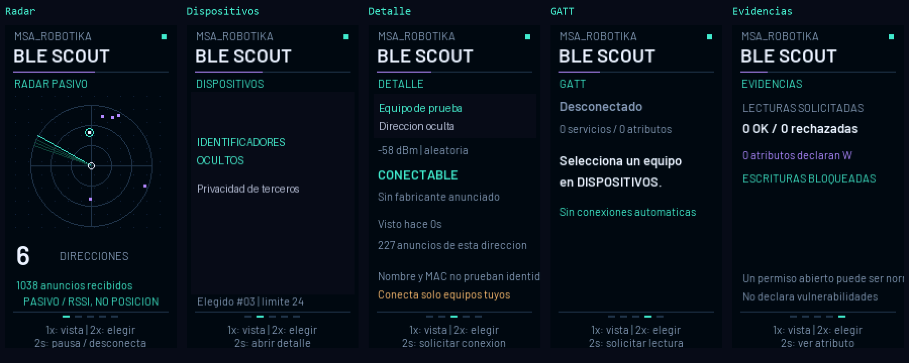

# MSA BLE Scout

**Un inspector Bluetooth LE de bolsillo, con pantalla y controles físicos.**

Proyecto experimental de MSA_Robotika para aprender a auditar tus propios dispositivos BLE: ver anuncios, explorar servicios GATT y comprobar lecturas concretas sin emparejarse ni escribir atributos.

Pocket BLE inspector for makers and ethical security students. Passive discovery, explicit GATT inspection on devices you own, local evidence export, and a standalone neon display. Experimental hardware-specific release; no pairing, no GATT writes, no automatic connections.



## Qué hace

- **Radar:** actividad real de anuncios, intensidad de señal y barrido animado. Los ángulos son ilustrativos: no localiza dispositivos.
- **Dispositivos:** lista de direcciones observadas, nombres anunciados y RSSI.
- **Detalle:** dirección y tipo, conectabilidad, identificador de fabricante cuando existe.
- **GATT:** conexión explícita a un dispositivo propio; enumera servicios y características, UUID y propiedades declaradas R/W/N.
- **Evidencias:** resultados reales de las lecturas solicitadas, rechazos y estado de cifrado. Las escrituras están desactivadas.
- **USB opcional:** exportar JSON y capturar la pantalla. Para usarlo normalmente basta alimentación USB; no necesita Python ni Windows.

Las capturas proceden del framebuffer del firmware instalado. Los identificadores de dispositivos cercanos se ocultan en las imágenes públicas; no se han añadido resultados simulados.

## Uso sin ordenador

No es táctil. **BOOT** controla la interfaz y **EN** reinicia.

| Acción | Resultado |
|---|---|
| Una pulsación corta y soltar | Siguiente vista, tras un breve intervalo para distinguir el doble toque |
| Doble pulsación en Dispositivos o Detalle | Seleccionar el siguiente dispositivo |
| Doble pulsación en GATT o Evidencias | Seleccionar la siguiente característica |
| Doble pulsación en Radar | Vaciar la lista, si no hay conexión ni operación pendiente |
| Mantener unos 2 s en Radar | Pausar/reanudar escaneo; desconectar si hay conexión |
| Mantener unos 2 s en Dispositivos | Abrir Detalle |
| Mantener unos 2 s en Detalle | Solicitar conexión; otra pulsación larga confirma que el equipo es tuyo |
| Mantener unos 2 s en GATT | Solicitar lectura de la característica seleccionada; otra pulsación larga confirma |
| Pulsación corta en una confirmación | Cancelar |
| Mantener unos 2 s en Evidencias | Volver a GATT |

En reposo las cinco vistas rotan aproximadamente cada 12 segundos. Una acción manual detiene esa rotación durante un minuto.

## Hardware probado

Placa ideaspark con módulo **ESP-WROOM-32 / ESP32-D0WD**, flash de 4 MiB y USB-UART CH340. Pantalla ST7789 con perfil **170 × 320**; el usuario ha confirmado imagen completa, orientación correcta y cambio de vista con BOOT. No es una ESP32-S3 y no incorpora USB nativo.

| Señal | GPIO |
|---|---:|
| TFT MOSI / SCLK | 23 / 18 |
| TFT CS / DC / RESET | 15 / 2 / 4 |
| Retroiluminación | 32 |
| BOOT | 0 |

Las placas parecidas pueden llevar otra pantalla o distribución de pines. El perfil secundario 135 × 240 está disponible para desarrollo, pero no está validado físicamente en esta versión.

## Compilar e instalar

Necesitas Python y PlatformIO Core. Plataforma fijada en `firmware/platformio.ini`; usa ESP-IDF y NimBLE.

```sh
python -m pip install platformio==6.2.0
python -m platformio run -d firmware -e scout
```

Antes de modificar otra placa, identifica su chip, MAC y flash, comprueba el pinout y conserva su copia original. No se distribuye el backup privado de la placa de desarrollo. Para una flash de 4 MiB y el puerto correcto, con esptool 5.6.0:

```sh
python -m pip install esptool==5.6.0
python -m esptool --port COM4 chip-id
python -m esptool --port COM4 flash-id
python -m esptool --port COM4 read-flash 0 0x400000 original.bin
python -c "import pathlib,hashlib; b=pathlib.Path('original.bin').read_bytes(); assert len(b)==4194304; print(hashlib.sha256(b).hexdigest())"
```

Sustituye COM4 por el puerto de tu placa. El tamaño y SHA-256 comprueban el archivo guardado; una segunda lectura idéntica permite una comprobación más fuerte. Guarda el hash fuera del archivo. **Instala únicamente después de verificar tu backup y la compatibilidad del hardware.** Cierra cualquier monitor serie antes de grabar.

```sh
python -m esptool --chip esp32 --port COM4 write-flash 0x1000 bin/bootloader.bin 0x8000 bin/partitions.bin 0x10000 bin/firmware.bin
```

`bin/SHA256.json` identifica los binarios distribuidos. No se requiere borrar toda la flash. El mapa usa una partición privada `scout_nvs` en 0x300000: puede sobrescribir datos del firmware anterior en esa región, por eso es imprescindible el backup completo. No se modifican eFuses ni microSD.

Para restaurar **tu** copia de 4 MiB, `tools/restore.py` exige el SHA-256 esperado y la MAC de destino antes de escribir.

## Capturas y evidencias por USB

```sh
python -m pip install -r tools/requirements.txt
python tools/device.py --port COM4 status
python tools/device.py --port COM4 devices
python tools/device.py --port COM4 page 0
python tools/device.py --port COM4 capture radar.png
python tools/device.py --port COM4 export evidencia.json
```

Puedes añadir `--mac MAC_DE_TU_PLACA` antes de la acción para comprobar el destino. Las acciones activas requieren confirmación explícita y un ID de la lista actual:

```sh
python tools/device.py --port COM4 connect 0 --confirm-owned-device
python tools/device.py --port COM4 read 0 --confirm-owned-device
python tools/device.py --port COM4 disconnect
```

El primer número es el ID de dispositivo; el segundo es un índice de característica de la sesión GATT. Revisa siempre la selección antes de confirmar. Las capturas tardan unos 10 segundos por la velocidad serie y detienen temporalmente el dibujo, no el receptor BLE.

## Alcance y privacidad

- Escaneo **pasivo de anuncios BLE legacy de 2,4 GHz**. No cubre Bluetooth clásico ni anuncios extendidos BLE 5.
- Hasta 24 direcciones, 12 servicios y 40 características. Se indican los límites/truncamientos. Los dispositivos no se reemplazan automáticamente: limpia la lista para observar otros.
- Una dirección aleatoria puede cambiar. Direcciones observadas no equivalen a personas ni a un inventario completo.
- No identifica intrusos, no detecta todos los ataques, no rastrea ubicación y no descifra tráfico ajeno. Un anuncio o una propiedad W no demuestra una vulnerabilidad.
- Conectar y leer son operaciones activas: úsalas solo sobre equipos propios o autorizados. Una lectura puede tener efectos específicos del dispositivo.
- No se inicia emparejamiento, no se guardan vínculos, no se suscribe a notificaciones y no se realizan escrituras GATT. No hay Wi-Fi, nube ni servidor de red activo.
- Anuncios y valores se conservan en RAM; las preferencias de pantalla sí persisten. Una lectura almacena como máximo 32 bytes del primer resultado, no una lectura larga completa.
- Los JSON exportados pueden contener nombres, direcciones y valores privados. Revísalos antes de compartirlos. Las capturas públicas de este repositorio están ocultadas donde corresponde.

## Validación y colaboración

Consulta [VALIDACION.md](VALIDACION.md) para conocer las pruebas reales y sus límites. Los tests de transporte se ejecutan con `python -m unittest discover -s tests`. El parser C tiene un harness de entradas malformadas y una tarea de CI con sanitizadores. La CI no sustituye las pruebas de radio y pantalla físicas.

Ideas de contribución: perfiles de placas documentados, fixtures GATT reproducibles, mejoras de accesibilidad y exportaciones que oculten identificadores por defecto. Incluye versión, placa, pasos y resultado esperado en cada incidencia; evita subir capturas de terceros o secretos.

Código propio bajo MIT. Fuente Barlow bajo SIL OFL, incluida en `Barlow-OFL.txt`. ESP-IDF y NimBLE conservan sus licencias upstream. Esta versión no incluye carcasa STL validada para esta placa.
